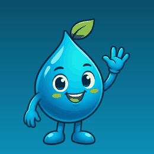

<table>
<tr>
<td width="250" align="center"></td>
<td align="left" valign="middle">
<h3>Oi! Eu sou o Pingo</h3>

O <b>Água Segura</b> mostra quantos dias a água da caixa ou da cisterna dura, avisa a hora de pedir o carro-pipa e guia a limpeza passo a passo.

Feito para <b>famílias e escolas</b>, com figuras, voz e letras grandes, para quem tem pouca prática com tecnologia.

</td>
</tr>
</table>

## Veja a água acabando

## Como funciona

## Dica do Pingo

## Você sabe cuidar da água? Clique e descubra

<b>1. A água está clara e sem cheiro. Então ela é sempre segura?</b>

 

**Não.** Cor e cheiro ajudam a notar problemas, mas não garantem que a água é própria para beber. Siga sempre o tratamento oficial da Vigilância em Saúde.

<b>2. Qual é a melhor forma de guardar a água?</b>

 

**Em reservatório tampado e limpo.** Isso protege de sujeira e de mosquitos.

<b>3. Posso usar a água reaproveitada de lavar roupa para beber?</b>

 

**Nunca.** Ela serve para limpar o quintal e a calçada. Se guardar, deixe tampada.

<b>4. De quanto em quanto tempo limpar o reservatório?</b>

 

Muitas orientações indicam **cerca de seis meses**, ou antes se houver sujeira. Confirme a proporção de água sanitária com a Vigilância em Saúde do seu município.

## Quem faz
<table>
<tr><td align="center"><b>Débora</b> Pesquisa e conteúdo</td><td align="center"><b>Samuel</b> Desenvolvimento</td><td align="center"><b>Jesiel</b> Ideias e testes</td></tr>
<tr><td colspan="3" align="center">Professor orientador: <b>Everton</b></td></tr>
<tr><td colspan="3" align="center">Escola: <b>EREM Abílio de Souza Barbosa</b></td></tr>
</table>

## Tecnologias

## Contribuições
<picture>
  <source media="(prefers-color-scheme: dark)" srcset="https://raw.githubusercontent.com/projetoaguasegura2026-ship-it/projetoaguasegura2026-ship-it/output/snake-dark.svg">
  <source media="(prefers-color-scheme: light)" srcset="https://raw.githubusercontent.com/projetoaguasegura2026-ship-it/projetoaguasegura2026-ship-it/output/snake.svg">
  
</picture>

